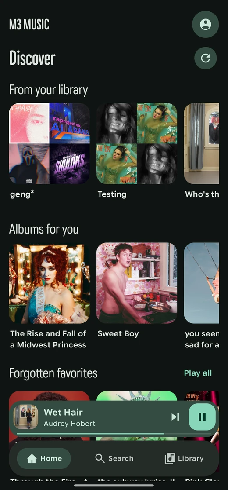
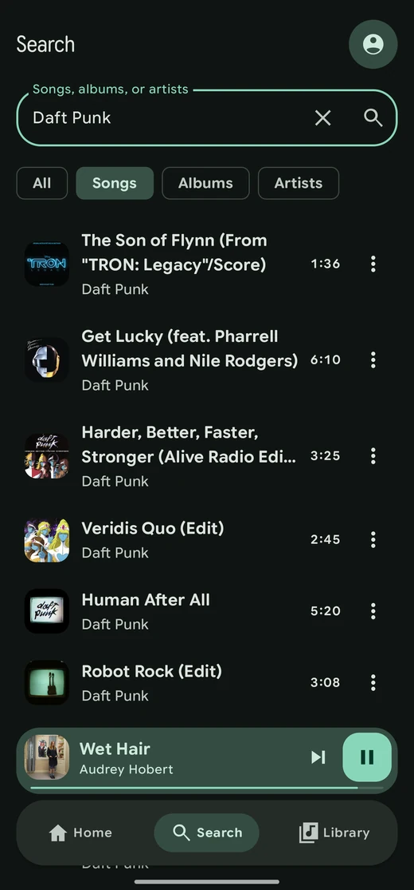
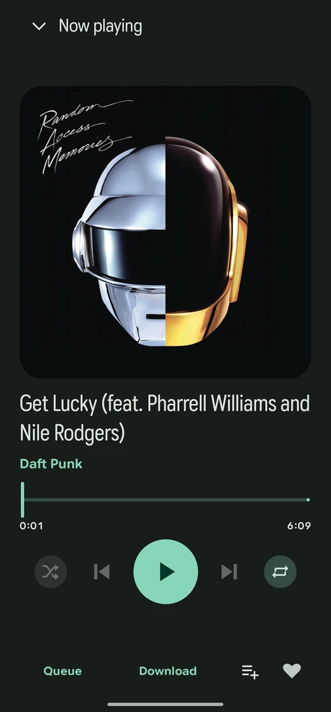
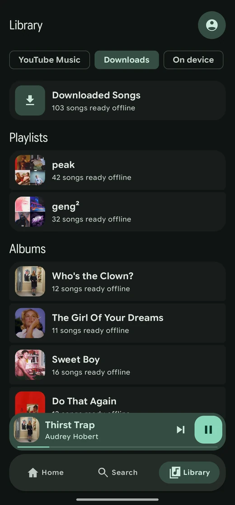

# M3 MUSIC

M3 MUSIC is a focused Android music player with a Material 3 Expressive interface
and an unofficial YouTube Music integration. It is independent of Google and
YouTube.

## App showcase

| Discover | Live Search |
| :---: | :---: |
|  |  |

| Now Playing | Offline Library |
| :---: | :---: |
|  |  |

## Features

- **Discover** YouTube Music recommendations and featured collections on Home.
- **Search as you type** for songs, albums, and artists, with filters and recent searches.
- **Manage your Library** with YouTube Music playlists, liked songs, saved albums,
  and followed artists alongside your on-device playlists. Create a playlist or
  add a track from Search or Now Playing.
- **Listen offline** with downloads grouped into Downloaded Songs, Playlists, and
  Albums. Home and Search offer a shortcut to Downloads while offline. Set
  Wi-Fi-only downloads under **Account → Settings**.
- **Control playback** from the mini-player, expanded Now Playing, or lock
  screen. Seek, shuffle, repeat, and drag songs to reorder the queue. Media3
  handles background playback and audio focus.
- **Make it yours** with Google Sans Flex, Material 3 Expressive motion, and an
  adaptive launcher icon. Wallpaper colors are available on Android 12 and later.
  Older devices use the built-in light and dark palettes.

## Version 1.0 (testing)

M3 MUSIC requires Android 8.0 (API 26) or later and a Google account. Sign-in
opens Google's web page in Android WebView. Search, streaming, and downloading
require an internet connection. Previously downloaded songs can play offline
with a saved session. Downloads are stored privately and removed when the app
is uninstalled.

### Known issues

- Google may interrupt embedded sign-in with a device verification prompt. This
  build permits the Google verification host reported by QA. The complete
  2-Step Verification flow still needs a retry on the affected device.
- Library's saved Albums filter can show an unsupported-page error. YouTube Music
  changes can also affect account access, search, or streaming.
- Background playback and offline downloads have been tested on a Xiaomi phone.
  Low-end performance and broader Android device compatibility still need testing.

## Build and install

Open this repository in Android Studio, install the SDK requested by the project,
and let Gradle sync. Run the `app` configuration on an emulator or a connected
Android phone. On Windows, the Android Studio bundled JDK can also build the QA
APK and run the local checks.

```powershell
$env:JAVA_HOME = 'C:\Program Files\Android\Android Studio\jbr'
.\gradlew.bat :app:assembleDebug :app:testDebugUnitTest :app:lintDebug
```

The installable QA build is at `app/build/outputs/apk/debug/app-debug.apk`. This
is a debug-signed APK. See the [verification instructions](docs/TESTING.md) for
device and live-network checks.

## Implementation

Jetpack Compose renders app state from `MusicViewModel`. NewPipeExtractor
resolves public-catalog streams, while Media3's playback service owns the player
and queue. The account library uses an unofficial web session stored with Android
Keystore protection. Disconnecting removes the saved session and account pages.
Local playlists, history, and downloads stay on the device. Private uploads and
account-specific playback entitlements are outside this testing build.

## References and acknowledgments

- [Material 3 Expressive](https://m3.material.io/blog/building-with-m3-expressive)
  guided the shapes, typography, and expressive transitions.
- [Google Sans Flex](https://fonts.google.com/specimen/Google+Sans+Flex) is the
  variable typeface used throughout the app.
- [Square](https://github.com/Lelonio/Square) informed the approach to YouTube Music
  integration and offline listening.
- [PixelPlayer](https://github.com/PixelPlayerHQ/PixelPlayer) was a design reference
  for the animated seek bar and Now Playing controls.
- [YouTube Music](https://music.youtube.com/) informed the organization of Home,
  Search, Library, and collection details.

M3 MUSIC is licensed under GPL-3.0-or-later. See [LICENSE](LICENSE) and
[third-party notices](THIRD_PARTY_NOTICES.md).
